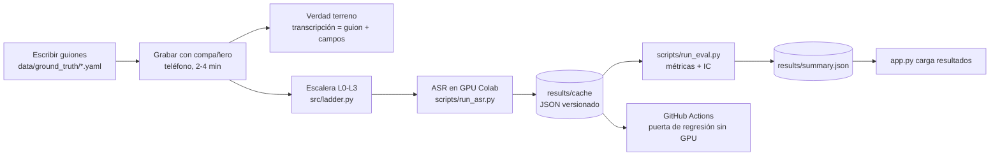
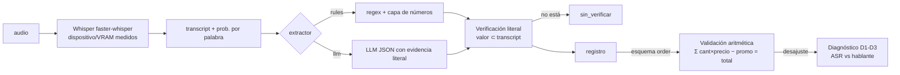

# Pipeline (versión Mermaid de respaldo)

> La tarea exige documentarlo en **Notion o Miro, público y enlazado en el README**. Este archivo es el
> contenido listo para copiar a esa herramienta (cada bloque = una sección/diagrama). Mermaid solo es el
> fallback si la herramienta falla; si lo usas, explica por qué en el README.

## Qué corre UNA vez

## Qué corre en CADA audio nuevo (`engine.process_audio`)

## Decisiones y descartes

| Paso | Decisión | Descartado y por qué |
|---|---|---|
| Verdad terreno | Guion escrito antes de grabar; el guion ES la referencia | Subtítulos de YouTube/ASR como referencia: evaluación circular |
| ASR | faster-whisper (CTranslate2), cuantización int8/float16 | openai-whisper: más VRAM; modelos solo-inglés |
| Dispositivo | Leído de `model.model.device` + VRAM por NVML | Confiar en `config.yaml`: el CPU fallback es silencioso |
| Normalización | Misma regla a referencia e hipótesis, números → dígitos | Comparar texto crudo: puntos y tildes inflan el WER |
| Números | Capa propia `numbers_es.py` | Dejar que Whisper decida dígitos/palabras: no es estable |
| Verificación | Evidencia literal + recálculo del valor desde la evidencia | Aceptar el JSON del LLM tal cual: puede "corregir" al ASR |
| Validación | Aritmética + reglas D1-D3 | Entrenar un clasificador con 4 llamadas: no hay datos |
| CI | Evaluar caché | Transcribir en Actions: los runners no tienen GPU |
| Motor | Un módulo, dos esquemas en `config.yaml` | Copiar el motor por tarea: costo al cambiar de modelo |
